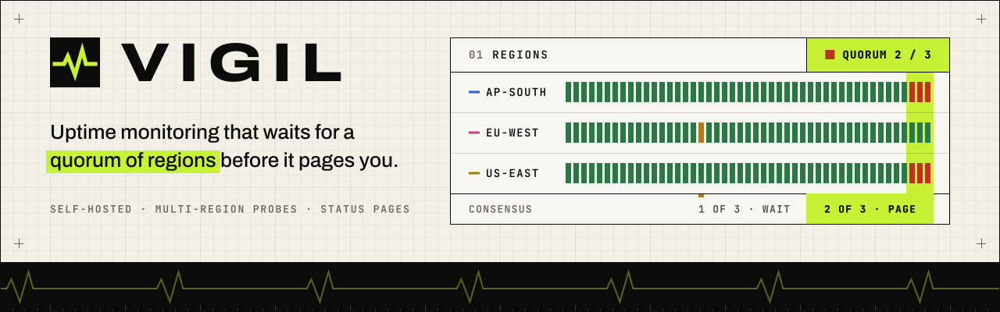
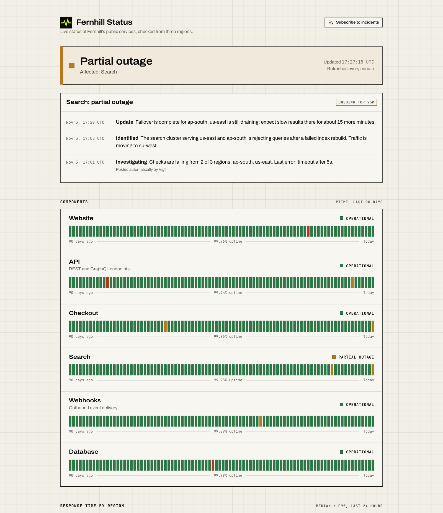
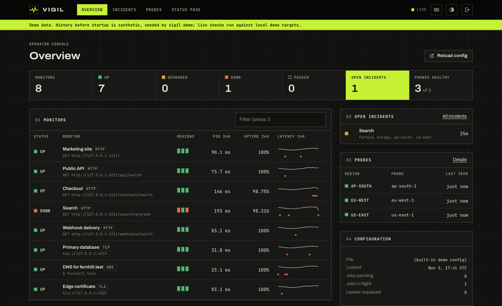
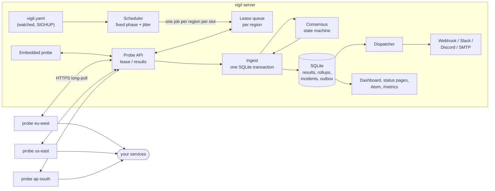
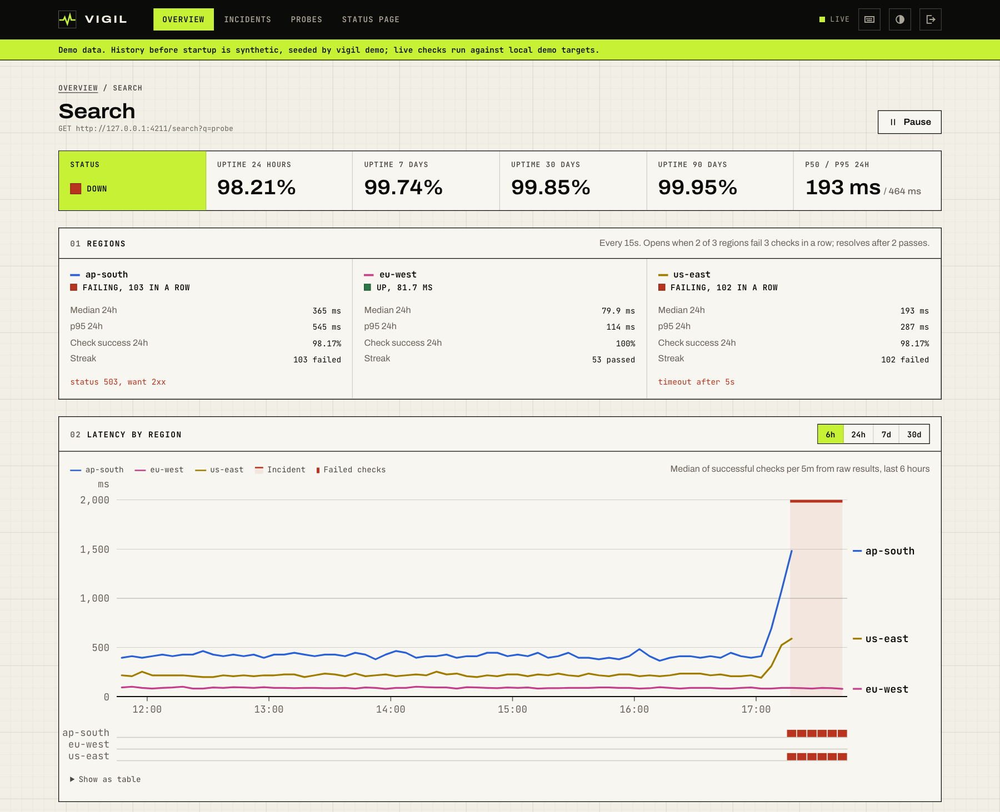

<picture>
  <source media="(prefers-color-scheme: dark)" srcset=".github/assets/banner-dark.svg">
  
</picture>

Vigil is a self-hosted uptime monitor that only pages you when a quorum of probe regions agrees something is down.

[](https://github.com/emirk35/vigil/actions/workflows/ci.yml)
[](LICENSE)
[](go.mod)
[](docs/adr/0001-sqlite-with-a-pure-go-driver.md)

 

## What it does

A single-location uptime checker cannot tell "the service is down" from "the path between my checker and the service is down". Every transit hiccup becomes a page at 3 a.m., and after a few of those people mute the channel. Vigil runs checks from several regions and treats each region as one vote. An incident opens only when enough regions see enough consecutive failures, and it resolves only after enough consecutive successes. Flapping services get one notice instead of twenty, every alert is deduplicated per incident and channel, and anything still broken gets reminders and escalation on a schedule.

It is one Go binary. `vigil server` runs the scheduler, the probe API, the operator dashboard, public status pages with an Atom feed, alerting (webhooks with Slack and Discord presets, SMTP email), and a `/metrics` endpoint. `vigil probe --region=eu-west` runs a remote checker anywhere that can reach the server over HTTPS. The server has an embedded probe, so a single node works with no extra setup. Monitors live in `vigil.yaml`, reload on change, and can be paused from the dashboard.

## Quick start

The demo seeds 90 days of clearly labelled synthetic history, starts local demo targets, and runs three in-process probes as three regions. Search starts in the middle of a partial outage and recovers on its own after about 12 minutes.

```sh
git clone https://github.com/emirk35/vigil && cd vigil
go run ./cmd/vigil demo
# status page  http://127.0.0.1:4210/
# dashboard    http://127.0.0.1:4210/admin   (token: demo)
```

To watch a full incident end to end in containers: a server, three probes as three regions, a deliberately flaky target, and Mailpit for email.

```sh
docker compose up --build
# dashboard  http://localhost:4210/admin   (token: compose-admin)
# mail       http://localhost:4212
docker compose logs -f target   # prints every webhook alert it receives
docker compose down -v
```

The target's `/flaky` endpoint cycles through 3 minutes healthy, 2 minutes failing only from eu-west, and 2 minutes failing everywhere. The regional failure shows as degraded and sends nothing. The outage opens an incident, sends one email and one webhook, and resolves with one of each. When the second outage ends, the monitor has flipped four times in 30 minutes, so Vigil marks it flapping, sends a single notice, and holds the incident open until it has been stable for a full window.

A single node checking real endpoints with its embedded probe (region `local`), then the config check you can run in CI:

```sh
go run ./cmd/vigil server --config examples/single-node.yaml   # status page at /status/main
go run ./cmd/vigil validate --config examples/single-node.yaml
```

To add regions, list them in a monitor's `regions`, start the server with `VIGIL_PROBE_TOKEN` set, and run one probe per region wherever it should check from: `vigil probe --server=<server URL> --region=eu-west`. [`examples/vigil.yaml`](examples/vigil.yaml) documents every option. Secrets come from the environment with `${NAME}`; [`.env.example`](.env.example) lists the server and probe variables.

## Architecture



The scheduler turns each monitor's interval into slots and enqueues one job per region per slot. Probes long-poll the lease endpoint for jobs in their region, run them, and post results. Each result is applied in one SQLite transaction: insert the result (idempotently), advance the monitor's consensus state, write any incident changes, and queue notifications in an outbox table. A dispatcher drains the outbox with retries. The dashboard subscribes to a server-sent event stream that only says "monitors changed"; each panel then re-fetches its own server-rendered HTML through htmx. A rollup job folds raw results into hourly and daily rollups and prunes by retention. [docs/architecture.md](docs/architecture.md) has the data model, wire protocol, and sequence diagrams.

## Deep dive: not waking people up for nothing



### Two levels of hysteresis

The consensus engine ([`internal/consensus`](internal/consensus/consensus.go)) is a pure state machine: results and clock ticks go in, effects come out (`open`, `resolve`, `impact_changed`, `notify`). It never touches the network, the database, or the wall clock, which is why it can be tested as a table of event sequences.

Each region carries its own small machine. It becomes **failing** after `fail_after` consecutive failures (default 3) and recovers after `recover_after` consecutive successes (default 2). One success inside a failure streak resets the streak. The monitor then asks a single question: are at least `quorum` of the currently reporting regions failing?

```go
unhealthy := len(failing) >= EffectiveQuorum(p, voting)
if unhealthy != s.Unhealthy {
	s.Unhealthy = unhealthy
	s.recordFlip(p, now)
}
switch {
case unhealthy && s.Incident == nil:
	// open; notify "opened", or "flapping" if this flip crossed the flap threshold
case unhealthy && s.Incident != nil:
	// the incident may widen from partial to major as more regions fail
case !unhealthy && s.Incident != nil:
	// resolve, unless flapping: then hold the incident open and say so once
}
```

Hysteresis at the region level means a recovering region has to prove itself twice before it stops voting "down", so an incident does not resolve and reopen on a single lucky check. With the defaults and a 30-second interval, an outage visible from two of three regions is confirmed within about 90 seconds. A failure visible from one region never pages anyone; the dashboard shows it as degraded.

### When probes disappear

Only regions that have reported within `3 × interval + timeout` vote. That raises a real question: what if two of three probes die? A fixed quorum of 2 would then never be reached, and the monitor would go silent exactly when infrastructure is failing. Vigil shrinks the quorum to the number of regions still voting (`min(quorum, voting)`, never below 1), on the view that a monitor that goes quiet is worse than one that pages on a single region's word. The dashboard flags regions with no healthy probe, so the reduced quorum is visible. An open incident never resolves for lack of data; it waits for evidence.

### Flapping, reminders, escalation, and deduplication

Every change of the monitor-level verdict is a flip. When `flap.threshold` flips (default 4) land within `flap.window` (default 30 minutes), the monitor is flapping: the current incident is held open, one `flapping` alert goes out, and nothing else is sent until the verdict has been stable for a full window. Then the incident resolves normally, or stays open as a regular outage. Reminders (`renotify`) and a one-time escalation (`escalate.after`, to a separate notifier list) are timers evaluated on every tick. Once escalated, reminders and the resolution also reach the escalation channel, so the person who was paged hears that it is over.

Alerts are not sent from the state machine. They are rows in a `notifications` table written in the same transaction as the state change, with a unique index on `(notifier, dedup_key)`:

```go
func DedupKey(monitorID string, opened time.Time, a consensus.Alert, seq int) string {
	key := fmt.Sprintf("incident/%s/%d/%s", monitorID, opened.UnixMilli(), a)
	if seq > 0 {
		key += fmt.Sprintf("/%d", seq) // reminders are numbered
	}
	return key
}
```

Whatever raises an alert twice (a replayed result, a crash between commit and send, a tick racing a result), only one row exists per channel. Delivery is at least once: a crash after a successful send but before marking the row sent causes one resend on restart, which is why every webhook and email carries the key as `X-Vigil-Delivery`. Opened alerts wait about one check timeout before sending and are rendered with the incident's extent at send time, because the other regions' results for the same slot usually arrive a moment later; without that, an outage seen everywhere would announce itself as "partial". The integration test in [`internal/server/server_test.go`](internal/server/server_test.go) starts a server and three HTTP probes, drives a target up, down, and up, and asserts exactly one incident and exactly one `opened` and one `resolved` alert per channel.

### The lease protocol

Probes pull work. `POST /api/v1/probe/lease` long-polls for up to 20 seconds and returns jobs with a lease **TTL**, a duration rather than a deadline. The server tracks expiry on its own monotonic clock and the probe computes its local deadline from the moment the response arrived, so a probe whose wall clock is minutes off still behaves correctly. Probe time is only used to show clock skew on the dashboard.

If a probe dies mid-check, its lease expires (check timeout plus 5 seconds of grace) and the job goes back to the front of the region's queue for another probe, once. If the first probe was merely slow and reports after all, both results carry the same job ID, which is also the result's primary key:

```sql
INSERT INTO results (id, monitor_id, region, probe_id, slot, received_at, ok, latency_ms, ...)
VALUES (?, ?, ?, ?, ?, ?, ?, ?, ...)
ON CONFLICT (id) DO NOTHING
```

Only a newly inserted row advances the state machine. This matters more than it looks: with `fail_after: 3`, a single result delivered twice would otherwise turn two real failures into an incident. The probe keeps unacknowledged results in an outbox and retries with backoff until the server answers `accepted`, `duplicate`, or `unknown` (a job from a server process that has since restarted). The state machine also ignores any result whose slot is not newer than the region's last applied slot, so late and out-of-order deliveries cannot rewrite a streak.

When a check is still in flight at its next slot, the new slot is dropped rather than queued behind it, and a slot nobody has leased yet is replaced by the newer one. A slow target or a missing probe therefore costs at most one pending job per monitor and region, never a backlog.

### The scheduler

Every monitor gets a fixed phase inside its interval from an FNV hash of its ID, anchored to the Unix epoch. 600 monitors on a one-minute interval spread over the minute instead of firing at :00, restarts and config reloads do not move anyone's slots, and all regions of a monitor share a slot, which is what consensus compares. A random jitter of up to 10% of the interval (at most 2 seconds) is added to each dispatch so two monitors that hash into the same instant do not collide every time. A newly added monitor whose first slot is more than 30 seconds away gets one warm-up check within 30 seconds (spread by the same hash), so an hourly certificate check does not show "no data" for an hour. After a long pause, such as a suspended laptop, only the newest slot runs. Replaying the backlog would be the thundering herd the phases exist to prevent. The tests drive all of this with an injected fake clock.

### Uptime and percentiles

Uptime is computed from incidents, not from raw checks. A minute counts as down only if consensus said so, so one region's bad network path does not dent the public number. Per-region check success rates are reported separately on the monitor page. Days before a monitor existed are "no data", not 100%.

Latency percentiles cannot be averaged: the mean of 24 hourly p95s is not the daily p95. Each rollup stores a small mergeable histogram in the style of DDSketch, with logarithmic buckets that bound the relative error of any quantile to 2%:

```go
const Accuracy = 0.02
var gamma = (1 + Accuracy) / (1 - Accuracy)
func index(ms float64) int32 { return int32(math.Ceil(math.Log(ms) / logGamma)) }
```

Merging two sketches adds bucket counts, which is exact, so hourly rollups merge into daily ones and any window can be answered from rollups. A property test checks the 2% bound against exact quantiles on several distributions, and another checks that merge equals the sketch of the union. Raw results are kept 7 days, hourly rollups 90 days, and daily rollups 400 days by default. Rollups run from a persisted watermark rather than a fixed lookback, so a server that was down for a day catches up instead of leaving a hole that pruning would later make permanent. Only successful checks feed the latency sketch; a timeout's "latency" is the timeout.

## Design decisions

- [0001: SQLite with a pure-Go driver](docs/adr/0001-sqlite-with-a-pure-go-driver.md), and how to move to Postgres.
- [0002: Probes pull leased jobs over HTTP](docs/adr/0002-probes-pull-leased-jobs.md) instead of the server pushing work or using a broker.
- [0003: Consensus as a pure state machine](docs/adr/0003-consensus-as-a-pure-state-machine.md), including the shrinking quorum.
- [0004: A transactional outbox for alerts](docs/adr/0004-transactional-outbox-for-alerts.md).
- [0005: Server-rendered UI with htmx and SVG](docs/adr/0005-server-rendered-ui-with-htmx-and-svg.md).

## Testing

```sh
make test     # go test -race ./...
make lint     # gofmt, go vet, staticcheck
make bench    # sketch, state machine, and ingest benchmarks
```

The state machine has a table of scripted scenarios (quorum, streak resets, widening impact, stale regions, escalation timing, flapping) plus a randomized test that checks invariants over 300 seeds: never two open incidents, never a resolution without an open incident, flapping only with an incident held open. The scheduler and lease queue run on a fake clock. Check runners are tested against `httptest` servers and in-process TLS, TCP, and DNS servers (timeouts, redirect limits, unknown authorities, expired and soon-to-expire certificates, JSON assertions, NXDOMAIN). Alert presets are checked for payload shape and HMAC signatures, and email against a fake SMTP server. Web tests render the dashboard and status pages over the seeded demo data, post an operator update, and parse the Atom feed. The server tests are the end-to-end ones described above.

Benchmarks, Apple M2 Pro laptop, `go test -run '^$' -bench . -benchmem ./internal/sketch ./internal/consensus ./internal/engine`:

| Benchmark | Result |
|---|---|
| Sketch insert | 18.9 ns/op, 0 allocs |
| Merge 24 hourly sketches and read p95 | 37.9 µs/op |
| State machine transition | 77.0 ns/op, 0 allocs |
| One result through the full write path (lease, insert, transition, state save in SQLite) | 94.0 µs/op |

The last number is a single writer on a small database. It says SQLite is not the bottleneck for hundreds of monitors; it is not a capacity claim.

## Project structure

```
cmd/vigil/           CLI: server, probe, demo, demo-target, validate, healthcheck
internal/consensus/  the incident state machine
internal/engine/     scheduler slots to jobs, ingest transactions, timers, rollups
internal/scheduler/  phase-hashed, jittered slots
internal/lease/      per-region job queue with leases
internal/probe/      probe lease loop, at-least-once reporter, HTTP client
internal/probeapi/   wire types shared by server and probes
internal/check/      HTTP, TCP, DNS, and TLS runners
internal/store/      SQLite, migrations, queries
internal/sketch/     mergeable latency sketch
internal/uptime/     incident-based availability
internal/alert/      templates, webhook presets, SMTP, outbox dispatcher
internal/web/        dashboard, status pages, Atom, SSE, embedded assets
internal/chart/      server-side SVG charts
internal/demo/       demo targets and the 90-day seeder
deploy/compose/      config for docker-compose.yml
examples/            reference and single-node configs
```

## Roadmap

- Per-probe credentials (or mTLS) instead of one shared probe token, so a leaked token can be revoked for one region.
- A Postgres store behind the same interface for multi-server deployments; [ADR 0001](docs/adr/0001-sqlite-with-a-pure-go-driver.md) sketches the path.
- Scheduled maintenance windows that suppress alerts and show on status pages ahead of time.
- Per-page time zones for status pages; days are UTC today.
- Status page subscriptions by email, alongside the Atom feed.

## License

[MIT](LICENSE)
