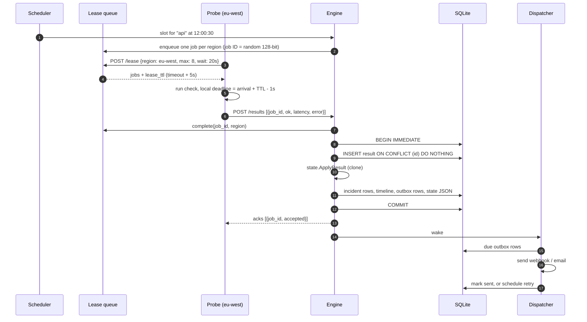
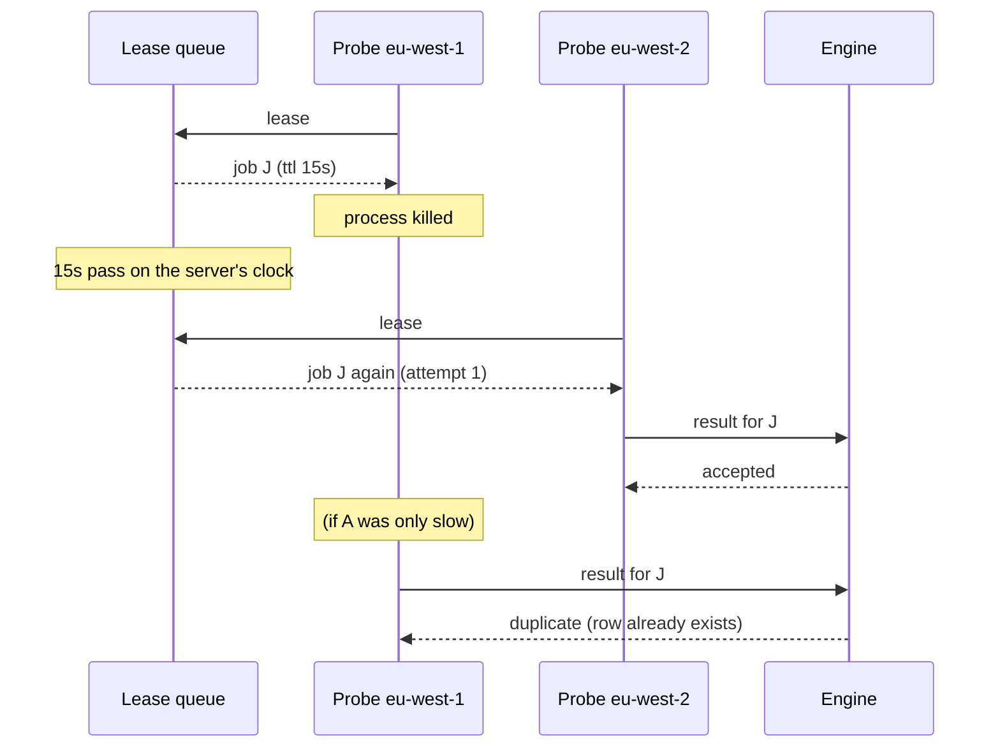
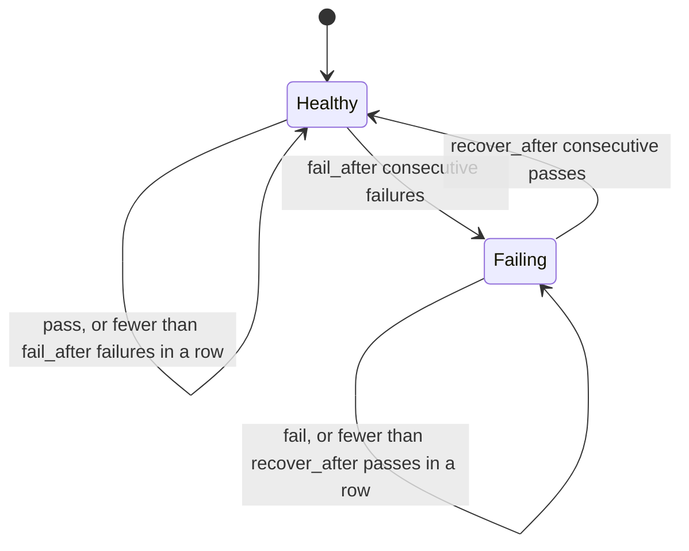
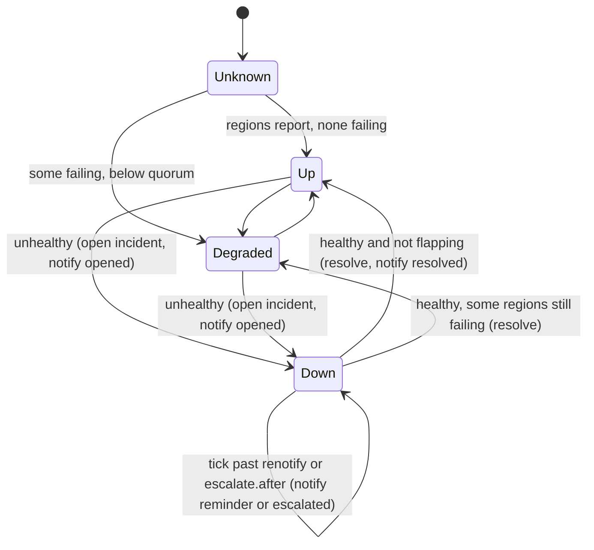

# Architecture

This document goes one level below the README: how the pieces fit, what is stored where, what travels over the wire, and what happens in the failure cases that shaped the design.

## Components

| Package | Responsibility |
|---|---|
| `internal/config` | Parse `vigil.yaml`, expand `${ENV}` references, apply defaults, and report every validation problem at once. Produces a resolved `config.Config` where each monitor carries a ready `check.Spec` and `consensus.Policy`. |
| `internal/scheduler` | Turn monitors into slots. Owns a min-heap of next dispatch times and calls back once per slot. |
| `internal/lease` | Per-region job queue. Leases jobs to probes with a TTL, expires and requeues them, coalesces slots. |
| `internal/engine` | The server's core. Creates jobs from slots, serves leases, ingests results, runs the consensus machine, persists effects, runs timers and rollups. The only writer of monitor state. |
| `internal/consensus` | The pure incident state machine. |
| `internal/probe` | The probe process: lease loop, bounded concurrency, at-least-once reporter, HTTP client. |
| `internal/check` | Check runners: HTTP(S), TCP, DNS, TLS. |
| `internal/store` | SQLite access, migrations, rollup computation, retention. |
| `internal/alert` | Message model, text templates, webhook presets, SMTP, outbox dispatcher. |
| `internal/web` | Dashboard, status pages, Atom feed, SSE hub, embedded templates and assets. |
| `internal/chart` | Server-side SVG for uptime bars, latency charts, sparklines. |
| `internal/server` | Wiring, HTTP middleware, probe API, config reload, embedded probe, shutdown. |

The engine holds one mutex around state transitions. SQLite allows one writer at a time anyway, and a single lock makes it obvious that a monitor's in-memory state and its persisted copy never diverge: a transition is applied to a clone, written in a transaction, and only swapped in after commit.

## A check, from slot to alert



## A probe dies mid-check



A job is requeued once; after its second lease expires it is dropped and the next slot takes over. While a job is leased, newer slots for the same monitor and region are dropped rather than queued, and a job still waiting for a probe is replaced by the newer slot. Each monitor and region therefore has at most one job pending, so a region with no live probe never accumulates a backlog.

If the server restarts, in-flight job IDs are forgotten. Probes reporting them receive `unknown` and drop the result. That costs one sample per monitor and region and keeps the server from accepting results for jobs it never issued.

## Incident state

The consensus machine has two layers. Each region:



And the monitor, where `unhealthy` means at least `min(quorum, reporting regions)` regions are failing:



The state is persisted as JSON in `monitor_state` after every transition, so a restart resumes with streaks and the open incident intact. Pausing a monitor stops scheduling and drops its queued jobs; resuming clears region streaks so results from before the pause cannot complete a new streak.

## Data model

All times are Unix milliseconds, UTC, from the server's clock.

| Table | Purpose |
|---|---|
| `monitors` | Mirror of configured monitors plus the operator's `paused` flag. Monitors removed from the config are marked `archived` so their history stays readable. |
| `monitor_state` | One JSON document per monitor: the consensus `State`. |
| `results` | One row per check result. `id` is the job ID and is unique: the idempotency key for at-least-once delivery. Indexed by `(monitor_id, slot)`. |
| `rollups` | `(resolution, monitor_id, region, bucket)` with `total`, `ok`, and a binary latency sketch of successful checks. `resolution` is `hour` or `day`. |
| `incidents` | One row per incident, unique on `(monitor_id, opened_at)`. Stores the peak impact and the union of failing regions, so history does not narrow as regions recover. |
| `incident_updates` | Timeline entries, authored by `vigil` or `operator`. Shown on public status pages. |
| `notifications` | The outbox. Unique on `(notifier, dedup_key)`. Holds the rendered message snapshot, status, attempts, next attempt time. |
| `probes` | Last seen, version, region, clock skew, completed checks. Heartbeats are throttled to one write per probe every 5 seconds. |
| `meta` | Rollup watermark, last prune, demo marker. |

The state machine names incidents by `(monitor, opened_at)` instead of a database ID. That keeps it free of storage concerns, and the same pair forms the stable part of every dedup key.

## Rollups and retention

Every minute the engine recomputes hourly rollups for hours from the persisted watermark up to now, from raw results, and recomputes daily rollups for the affected days from hourly ones. Recomputing whole buckets keeps the job idempotent: running it twice over the same hours converges on the same rows. The watermark trails real time by five minutes so the hour that just ended is recomputed once more after its last late result. Pruning runs at most hourly, after rollups, with defaults of 7 days raw, 90 days hourly, 400 days daily.

Readers pick the cheapest source that answers the question: the 6-hour and 24-hour charts read raw results, the 7-day and 30-day charts merge hourly sketches into 1-hour and 6-hour buckets, and status page latency merges the last 24 hourly sketches per region. Uptime bars read incidents only.

## Wire protocol

Both endpoints take and return JSON and require `Authorization: Bearer <VIGIL_PROBE_TOKEN>`. Durations are integer nanoseconds, as Go encodes `time.Duration`.

```http
POST /api/v1/probe/lease
{"probe_id": "eu-west-1", "region": "eu-west", "version": "1.0.0",
 "max": 16, "wait": 20000000000, "probe_time": "2026-11-03T12:00:29Z"}

200 OK
{"jobs": [{"id": "9f2c...", "monitor_id": "api", "region": "eu-west",
           "slot": "2026-11-03T12:00:30Z", "attempt": 0, "lease_ttl": 15000000000,
           "spec": {"type": "http", "timeout": 10000000000,
                    "http": {"url": "https://api.example.com/healthz", "method": "GET", "expect": {"status": ["200"]}}}}],
 "server_time": "2026-11-03T12:00:30.004Z"}
```

```http
POST /api/v1/probe/results
{"probe_id": "eu-west-1", "region": "eu-west",
 "results": [{"job_id": "9f2c...", "ok": false, "latency": 10000412000,
              "error": "timeout after 10s"}]}

200 OK
{"acks": [{"job_id": "9f2c...", "status": "accepted"}]}
```

`status` is `accepted`, `duplicate`, or `unknown`. A result missing from `acks` (a storage error on the server) is retried by the probe.

## Live updates

The dashboard opens one EventSource on `/admin/events`. The engine publishes three topics (`monitors`, `incidents`, `probes`), debounced to at most one event per topic per second, and the events carry no data. Each panel declares which topics invalidate it and re-fetches its own page with `hx-select`, so the HTML that arrives over SSE-triggered refreshes is the same HTML a full page load renders. Public status pages poll once a minute and are cacheable for 15 seconds.

## Configuration reload

The file is re-read on `SIGHUP`, from the dashboard's reload button, and when its modification time changes (polled every 3 seconds, which works on bind mounts where inotify does not). A reload that fails validation leaves the running config in place and shows the error on the dashboard. Monitors keep their state and schedule phase across reloads; a changed interval starts the monitor at its next slot under the new interval.

## Shutdown

On `SIGINT` or `SIGTERM` the server closes SSE streams, stops the engine (which closes the job queue and so releases every long-polling probe immediately), lets the embedded probe finish its in-flight checks and report them, drains HTTP with a 10-second limit, and makes a final 5-second pass over the outbox. Remote probes shut down the same way from their side: stop leasing, finish in-flight checks (bounded by each check's timeout), and flush unreported results for up to 10 seconds.
